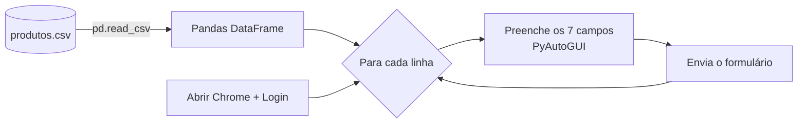

<h1 align="center">Automação de Cadastro de Produtos</h1>

<p align="center">
  <b>Script de RPA em Python que cadastra em lote, num sistema web, os produtos de uma planilha CSV.</b>
</p>

<p align="center">
  
  
  
  
</p>

<p align="center">
  <a href="#-como-rodar-localmente">Rodar localmente</a> ·
  <a href="#-decisões-técnicas">Decisões técnicas</a> ·
  <a href="#️-limitações-conhecidas">Limitações</a>
</p>

---

## 🎯 O problema

Muitos sistemas internos não têm importação em lote nem API: o cadastro é feito à mão, produto por produto, preenchendo sete campos de um formulário. Com **293 produtos** na base, isso é trabalho repetitivo, demorado e sujeito a erro de digitação.

## ✅ A solução

Um robô (RPA) que opera o navegador como um usuário faria: abre o sistema, faz login, lê a planilha com Pandas e preenche e envia o formulário de cada produto, sem intervenção humana.

**Principais funcionalidades**

- Abre o Chrome e acessa o sistema automaticamente.
- Faz login com as credenciais de teste do sistema.
- Lê a base `produtos.csv` (código, marca, tipo, categoria, preço unitário, custo e observação).
- Preenche e envia o formulário para cada linha da tabela.
- Pula o campo de observação quando ele está vazio na planilha, em vez de escrever "nan".

## 📸 Demonstração

🎬 *GIF da execução em breve.*

<!-- Grave um GIF de 10–15 s do robô preenchendo 2 ou 3 produtos (ScreenToGif no Windows), salve em docs/img/demo.gif,
     apague a linha acima e descomente o bloco abaixo:
<p align="center">
  
</p>
-->

## 🛠️ Tecnologias

| Camada | Tecnologia | Por que escolhi |
|---|---|---|
| Linguagem | Python 3.13 | Sintaxe enxuta e o ecossistema mais usado para automação e dados. |
| Automação | PyAutoGUI | Controla mouse e teclado do sistema operacional, então funciona com qualquer interface, mesmo sem API ou integração. |
| Dados | Pandas | Lê o CSV em uma linha e trata valores ausentes (`pd.isna`) de forma confiável. |
| Sincronismo | `time` + `pyautogui.PAUSE` | Pausas entre ações para a página carregar antes do próximo comando. |

## 🧱 Arquitetura



**Estrutura**

```
automacaodecadastro/
├── automacaodecadastro.py   # script principal
├── produtos.csv             # base com 293 produtos
├── posicao.py               # utilitário: mostra a posição do mouse para mapear os cliques
└── teste.py                 # pré-visualiza as 5 primeiras linhas da base antes de rodar
```

## 💡 Decisões técnicas

- **Automação por interface (PyAutoGUI) em vez de requisições HTTP**: o objetivo era simular um sistema legado sem API, onde só a tela está disponível. *Trade-off:* depende de resolução e posição dos elementos (veja Limitações).
- **Navegação por `Tab` entre os campos**: só o primeiro campo é clicado por coordenada; os demais são alcançados pelo teclado, o que reduz a dependência de posições na tela.
- **`pyautogui.PAUSE = 1` + `sleep` no login**: deixa o script mais lento, mas evita que comandos sejam enviados antes da página responder.
- **Checagem de `NaN` na observação**: o Pandas lê células vazias como `NaN`; sem a checagem, o robô escreveria "nan" no formulário.
- **Utilitário `posicao.py`**: separa o mapeamento das coordenadas da automação em si, facilitando adaptar o script a outra tela.

## 🚀 Como rodar localmente

**Pré-requisitos:** Python 3.13+, Google Chrome e Windows (o script usa a tecla Win para abrir o navegador).

```bash
# 1. Clonar
git clone https://github.com/diegoomarcelo/automacaodecadastro.git
cd automacaodecadastro

# 2. Instalar dependências
pip install pyautogui pandas

# 3. (Se a sua resolução for diferente) mapear as posições dos cliques
python posicao.py

# 4. Executar e não mexer no mouse/teclado durante a execução
python automacaodecadastro.py
```

> 🛑 **Para interromper:** leve o mouse rapidamente a um canto da tela (*failsafe* do PyAutoGUI).

## ⚠️ Limitações conhecidas

- As coordenadas de clique foram mapeadas para uma resolução específica; em outra tela é preciso ajustá-las com `posicao.py`.
- O script não confirma se cada cadastro foi aceito pelo sistema; ele segue a sequência de ações.

## 🗺️ Próximos passos

- [ ] Ler URL e credenciais de variáveis de ambiente (`.env`) em vez de deixá-las no código.
- [ ] Trocar coordenadas fixas por Selenium ou Playwright, localizando os campos pelo HTML.
- [ ] Gerar um log com os produtos cadastrados e os que falharam.

## 👤 Autor

**Diego Marcelo**, Desenvolvimento de Software e Dados
[LinkedIn](https://linkedin.com/in/diegomarcelo) · [GitHub](https://github.com/diegoomarcelo) · diegoomarcelo@gmail.com
